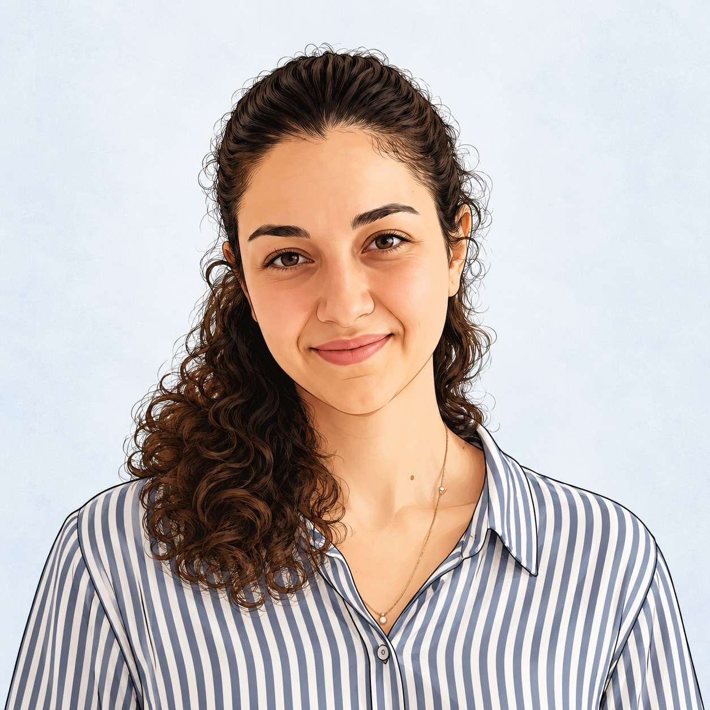

# Noa Sofer Sali, MD

Welcome to My Website

## About Me

I'm a physician. I earned my MD and MPH from the Hebrew University and completed my internship at Soroka Medical Center.
I currently serve in the IDF Medical Corps and started my MSc in Life Sciences at the Weizmann Institute of Science

## Research Interests

My interest in neurology and neuroscience, particularly neurotrauma, grew from my experience caring for injured patients. 
I am interested in understanding how brain injury affects cognition and daily functioning, and how advances in neuroscience and neurotechnology can improve treatment and recovery.

## My Goals in This Class

Through this course, I aim to establish a foundation in programming and develop proficiency with AI-driven tools, with the goal of integrating these skills into my academic studies and research.

## Outside of Work

When I’m not at work, I enjoy reading, travelling with my husband, and spending time with our dog, Tromso.

